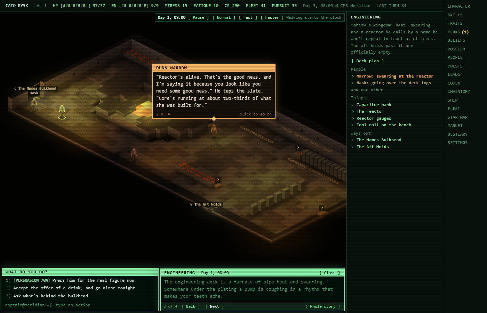
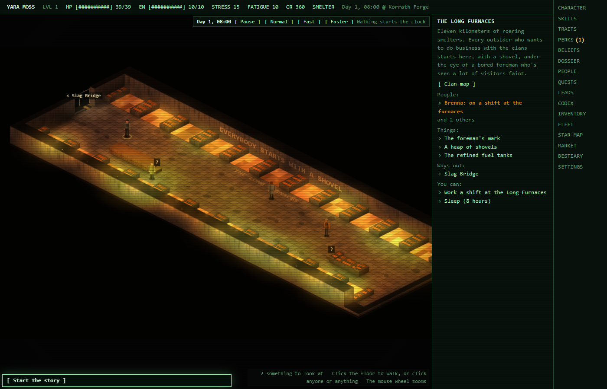
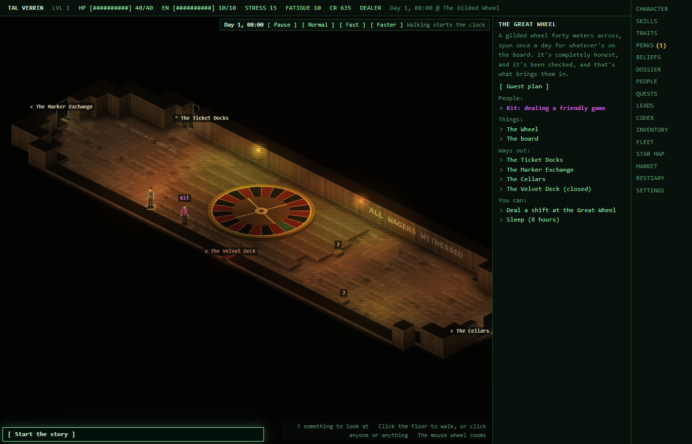
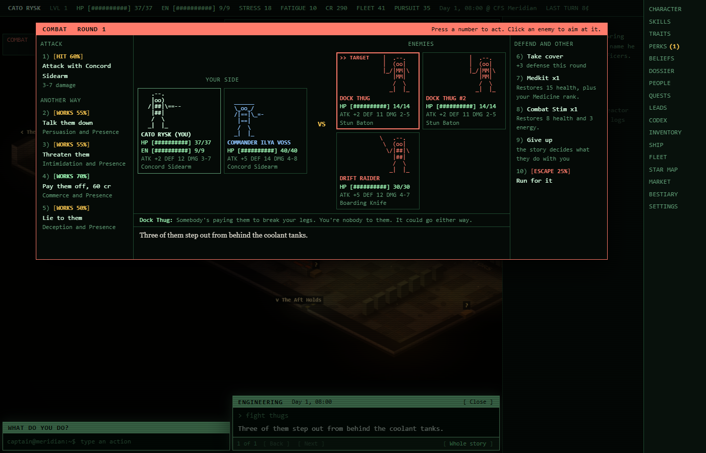
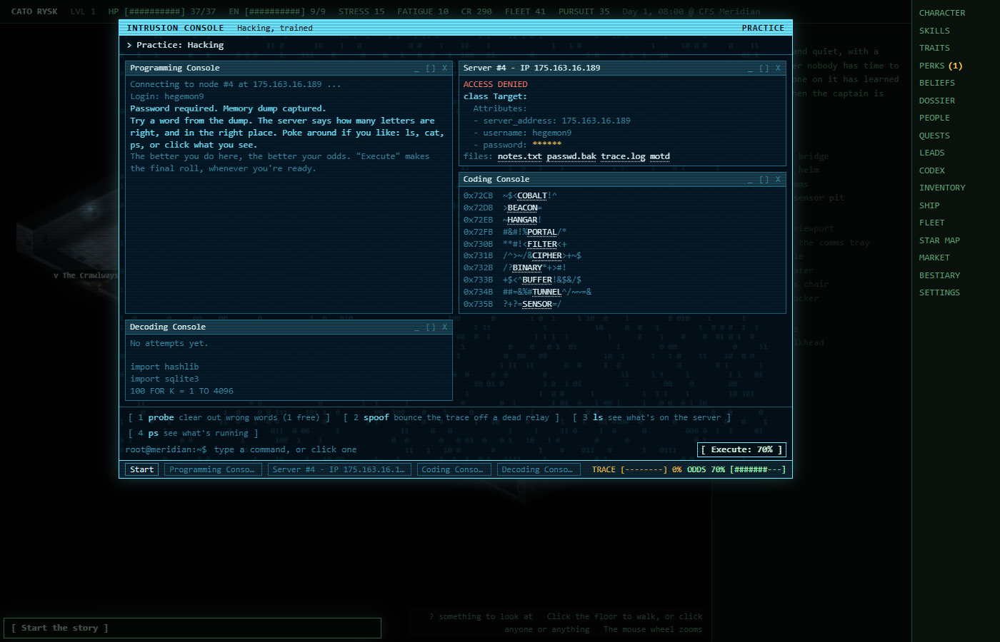
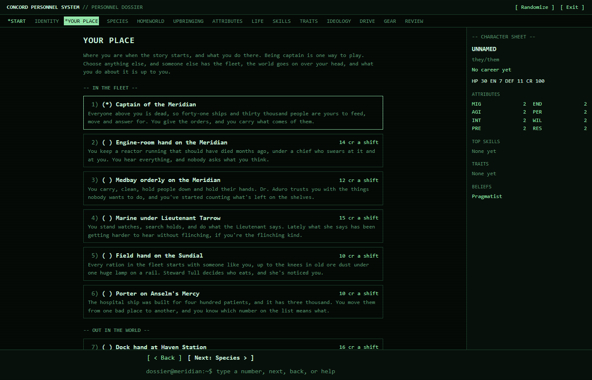
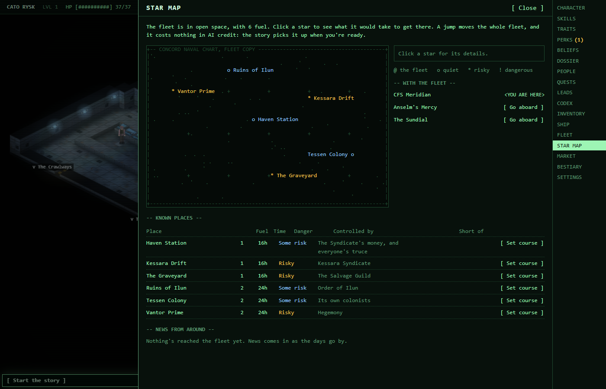

# The Last Meridian

DISCLAMER Hello I'm the solo "developer" working on this project. I would like to say that I do not have any experience nor knowledge of how to code; as such, I have used Claude's code to write the game. Knowing that AI is a divise subject right now (with merit I might have), I understand if it causes controversy and disinterest from you. That being said, this project is a passion project I wouldn't have been able to do without AI, though. NO AI was used to generate ART, MUSIC, etc. as I feel it is a HUMONGUS problem of AI right now. It is in my future plans to hire an artist to help me with the art; if you're interested, please contact me!

As it stands right now, AI is overwhelmingly present in every part of the project, my vision going forward would be to eliminate the use of AI progressively in a way that, in term, the AI would be an optional features to add dept to the story and make it feel more interactive and not the main part of the game. THIS IS NOT THE CASE RIGHT NOW, it is everywhere and the game is very much EARLY STAGE. If that sounds interesting to you then I would ask you to please give me feedback on your experience (bugs, ideas for features, how the menus feel) as I am now at university and working at the same time; I do not have the time to deeply test the game. I hope you enjoy it.

The style I have in mind for the finality of the project is the games AGE OF DECADENCE, Colony Ship: A Post-Earth Role Playing Game, both excellent games from a passionate developer!

MOREOVER : The description is written by AI. THIS WILL CHANGE SOON (and I will use my great skill of writing to do it!) as the project is merely 6 days old (as of 02/11/26 or 11/02/26) and I wanted to get the game out as soon as possible to get feedback. The code is MY PROPERTY now, like the story: it isn't open source anymore. I might have a patreon soon if you want to support me since I fear the cost of everything will slowly creep up

PS : English being my second language, please excuse the possible grammatical errors.


*Thirty thousand survivors. Forty-one ships. One signal from beyond the edge of the map. Where are you in all this?*

A sci-fi RPG for Windows where an AI writes the story and the game's own code keeps the rules fair. You can be the fleet's captain, a dock hand, a card dealer or a scavenger, and the world goes on with or without you.

**This is an early version, and feedback is what it needs most.** Most of the newest parts have hardly been played yet, so expect rough edges. If you try it, please [say what you think](https://github.com/chamer2011/last-meridian/issues/new?template=feedback.yml).



<table>
<tr>
<td width="50%"><br>The Long Furnaces at Korrath. The game draws all 122 rooms by itself.</td>
<td width="50%"><br>The Great Wheel, where you could start as a card dealer.</td>
</tr>
<tr>
<td width="50%"><br>Fights have other ways out: talk, threaten, pay or lie.</td>
<td width="50%"><br>Each skill has its own small game. This one is Hacking.</td>
</tr>
<tr>
<td width="50%"><br>There are 22 lives to start from, and only one is the captain.</td>
<td width="50%"><br>The star map, and how far the fleet's fuel will take it.</td>
</tr>
</table>

*These pictures come from a test game, so the story in them was written in advance, not live by the AI.*

## Try it

1. Download **[The-Last-Meridian-Setup.exe](https://github.com/chamer2011/last-meridian/releases/latest/download/The-Last-Meridian-Setup.exe)** (about 120 MB) and run it. Windows will warn that it's from an unknown publisher, because the installer isn't signed. To go ahead, press **More info**, then **Run anyway**.
2. Open **The Last Meridian** from your desktop or the Start menu, and press **New game**.
3. To start the story, add your own AI key, as explained below. Without one, you can still look around.

## What it costs

The game is free, but the story is written by Claude, an AI from Anthropic, and you pay Anthropic directly for what it writes:

1. Create an account at [console.anthropic.com](https://console.anthropic.com) and add a little credit. This is separate from a Claude subscription.
2. Under **API keys**, create a key and copy it.
3. In the game, open **Settings**, paste the key, and press **Save key**.

| AI | What it's like | A turn | Starting a session |
|---|---|---|---|
| Claude Opus 5.5 (the default) | The best writing and story memory | 5 to 8 cents | 20 to 35 cents |
| Claude Sonnet 5.5 | A good balance | 3 to 4 cents | 10 to 17 cents |
| Claude Haiku 5.5 | Fast and very cheap, but looser with the story format | Under 1 cent | About 1 cent |

These are rough figures in US cents, from a small number of real turns, and Sonnet's are worked out from its prices. They go up slowly as a story gets longer. Starting a session costs more because the AI has to read the game's rules and your story so far, and it does that again after a break of more than an hour. You can switch AI at any time in **Settings**, which also shows what you've spent, and the top of the screen shows what your last turn cost. Walking around, fights, menus and skill checks run on your computer and cost nothing.

**Your key** stays on your computer, saved in plain text, and only ever goes to Anthropic. The game doesn't contact anything else, apart from a local AI if you use one.

**With no key,** you can still make a character, walk around, watch people go about their day, read the menus, and try the skill games, plus the fight simulator if you start aboard the Meridian. Only the story has to wait.

**A local AI** is free, and the game has a setting for one through [Ollama](https://ollama.com). It needs a download of several GB and writes less well, and the game hasn't been tried with a real one yet.

## What's in it

- **A world that doesn't wait.** 24 places have their own supplies, prices and factions, which change day by day, and 127 stories move on by themselves if nobody steps in.
- **People with lives.** Over 300 people get up, go to work, eat and go to bed, whether you're watching or not.
- **Be whoever you like.** There are 22 lives to start from, and a character creator where you live out a career four years at a time.
- **A fleet that can lose.** 41 ships run out of food, fuel, medicine and parts, and they're run by you, or by whoever else has the captain's chair.
- **Fights with other ways out.** Talk them down, threaten them, pay them off or lie, with odds that depend on why they're fighting, how much they hate you and who's winning.
- **Skills you play.** Each of the 25 skills opens its own small game. Nothing's timed, and everything can be clicked.
- **An AI that keeps to the rules.** The AI writes the story, while the game's code rolls the dice and keeps the records, so it can't just decide how a fight or a check comes out.

The [full guide](GUIDE.md) explains how everything works.

## Spoilers

The `world` folder holds every secret in the story, including how it ends, because the game needs them to run. Keep out of it if you'd like to be surprised.

## Feedback

[Leave your feedback here](https://github.com/chamer2011/last-meridian/issues/new?template=feedback.yml). You'll need a free GitHub account, and short answers are fine. These are the most useful things to hear:

- Does the world feel alive?
- Was it clear what to do, and could you follow the story?
- Did the AI's story make sense, and did it stay consistent?
- What did a session cost you?
- What broke, and what were you doing when it did?

Ideas and bug reports are what's wanted for now, so please don't send code changes.

## Running it from the source

This is for anyone who'd rather not use the installer, or isn't on Windows, though Windows is the only system it's been tried on. Install a current [Node.js](https://nodejs.org) and [Git](https://git-scm.com), then run:

```bash
git clone https://github.com/chamer2011/last-meridian.git
cd last-meridian
npm install --omit=dev
npm start
```

Then go to http://localhost:3210.

## What you can do with it

**The game is its owner's property,** code, story and world: Copyright (C) 2026 chamer2011, all rights reserved. You're welcome to download it, play it and change your own copy, but not to share it, sell it or use any part of it in your own game. [LICENSE](LICENSE) says it in full, and [STORY-AND-WORLD.md](STORY-AND-WORLD.md) lists which files are the story and the world.

**The versions up to 0.3.0** went out with their code under GPL-3.0, and that still covers those versions for anyone who has them.

The game was built with [Claude Code](https://claude.com/claude-code), and the story you play is written live by Claude.
